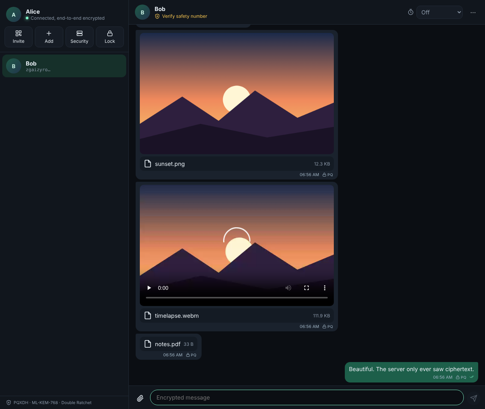
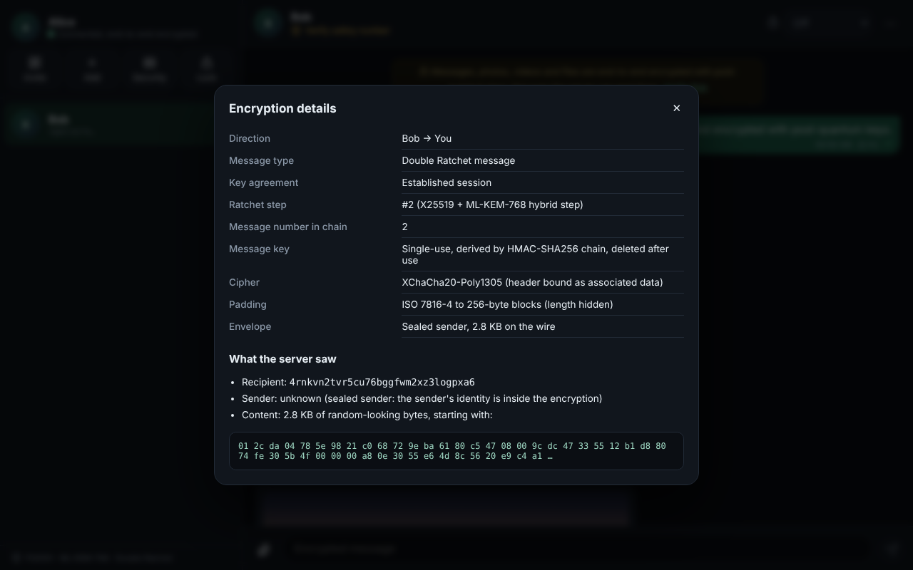
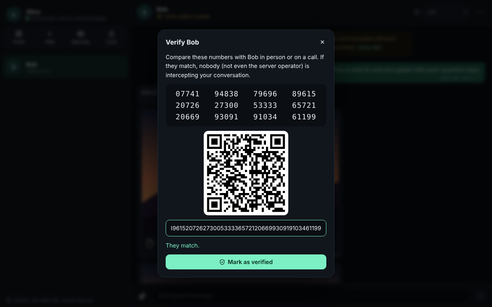
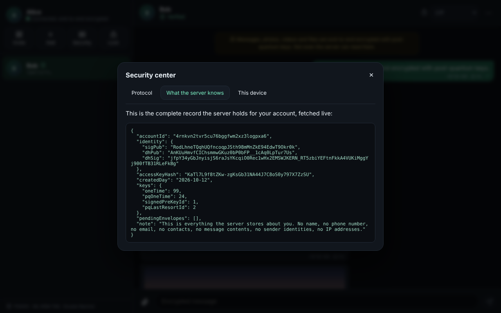
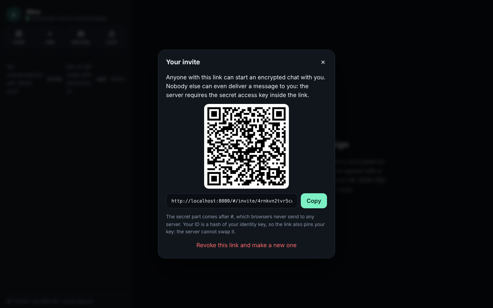
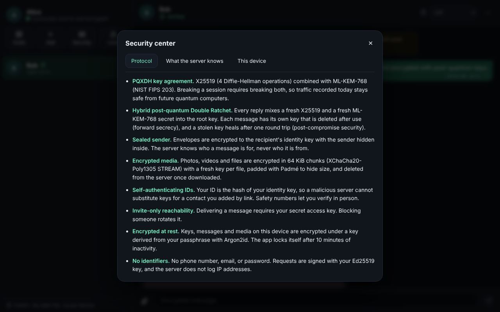
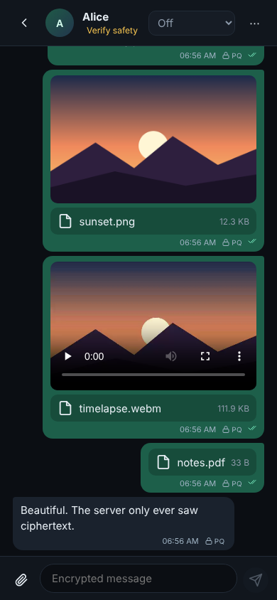
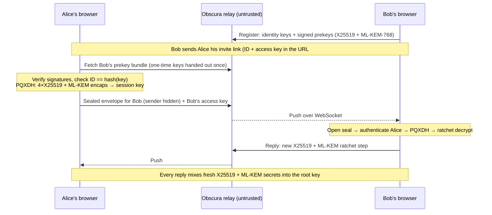

# Obscura

**A self-hosted, end-to-end encrypted messenger with post-quantum key agreement, a hybrid post-quantum Double Ratchet, and sealed sender.** Send texts, photos, videos and files that only the people in the conversation can read: not the server, not the network, and not a future quantum computer replaying today's traffic.



| | |
|---|---|
| **Key agreement** | PQXDH: 4× X25519 + **ML-KEM-768** (NIST FIPS 203). An attacker must break both. |
| **Ratchet** | Double Ratchet where **every turn** also runs a fresh ML-KEM-768 encapsulation: forward secrecy, post-compromise security, and quantum-resistant healing. |
| **Metadata** | **Sealed sender**: the server knows who a message is *for*, never who it is *from*. No phone, email, or password. No IP logging. |
| **Media** | Photos, videos and files up to 100 MB, encrypted in the browser with a fresh key per file (chunked XChaCha20-Poly1305 STREAM), size-padded, deleted from the server after download. |
| **Reachability** | Invite-only: delivering a message requires your secret access key. Blocking someone revokes it. |
| **Key authenticity** | Your ID *is* the hash of your identity key, so invite links pin keys and the server cannot swap them. 60-digit safety numbers + QR for in-person verification. |
| **At rest** | Everything on the device (keys, sessions, messages, media) is encrypted under an **Argon2id**-derived key (64 MiB). Auto-lock after 10 minutes. |
| **Primitives** | Only audited libraries (`@noble/*`). No hand-rolled crypto. `npm audit`: 0 vulnerabilities. |

---

## Quick start

**One command (Docker):**

```bash
docker compose up -d
# open http://localhost:8080
```

**On the public internet with automatic HTTPS** (point your domain's DNS at the server first):

```bash
DOMAIN=chat.example.com TRUST_PROXY=1 HSTS=1 docker compose --profile https up -d
# open https://chat.example.com
```

**Without Docker** (Node.js ≥ 22.13):

```bash
npm ci
npm run build
npm start            # serves the web app and the relay on http://localhost:8080
```

Then:

1. Open the app, pick a display name and a passphrase. Your keys are generated in your browser.
2. Click **Invite** and send the link or QR code to a friend. They open it, create an account, and an encrypted session starts automatically.
3. Chat, attach photos/videos/files (or drag and drop), set disappearing messages.
4. Click **Verify safety number** and compare the 60 digits in person to rule out any interception.

> For real use, serve it over HTTPS (the `https` profile does this). A web app's code comes from its server, so TLS is what stops a network attacker from tampering with it. See [Threat model](#threat-model).

### Running on Windows

Install [Docker Desktop](https://www.docker.com/products/docker-desktop/) and make sure it is running (whale icon in the tray). Then, in PowerShell inside the `obscura` folder:

```powershell
docker compose up -d
# open http://localhost:8080
```

**"ports are not available ... 8080"**: another program already uses port 8080. Pick a different port:

```powershell
$env:OBSCURA_PORT=8090
docker compose up -d
# open http://localhost:8090
```

**"error during connect ... docker_engine"**: Docker Desktop is not started yet. Open it, wait until it says *Engine running*, and retry.

To stop it: `docker compose down`. Your server data is kept in a Docker volume and survives restarts.

### Chat with a friend over the internet (free, no domain needed)

A Cloudflare quick tunnel gives your local server a temporary public `https://` link:

```powershell
winget install --id Cloudflare.cloudflared     # once; then open a NEW PowerShell window
cloudflared tunnel --url http://localhost:8090  # use your port
```

It prints a link like `https://something-random.trycloudflare.com`. Open that link yourself, create your account, click **Invite**, and send the invite to your friend.

Things to know:

* Keep the PowerShell window and Docker running. If you close them, the link stops working.
* Every restart of `cloudflared` gives a **new** link. The browser keeps your account per website address, so a new link means a fresh, empty account. For a link that stays the same, use a [named Cloudflare tunnel](https://developers.cloudflare.com/cloudflare-one/connections/connect-networks/) with your own domain, or host it on a server (below).
* Everyone behind the tunnel appears to come from one IP address, so the per-IP limits (20 sign-ups/hour, 240 messages/minute) are shared by everyone using the link.
* Cloudflare carries only encrypted traffic: messages are end-to-end encrypted before they leave the browser.

### Choosing a passphrase

The passphrase is something **you make up**, not your email or any other password. It encrypts the keys and chats stored in your browser and never leaves your device.

* Use 4 or 5 random words plus a number or symbol, e.g. `purple-tiger-river-candle-42` (don't copy this one). Minimum 10 characters; aim for **Strong** or **Excellent** on the meter.
* **Write it down somewhere safe.** There is no reset. If you forget it, the chats on that device are gone for good, and no one (including the server) can recover them.
* You need it when you come back, and after the app auto-locks (10 minutes idle). Your friend makes up their own; never share yours.

### Where to host it permanently

| Option | Cost | Notes |
|---|---|---|
| Your PC + Cloudflare tunnel | Free | Works only while your PC is on; link changes on restart |
| Same Wi-Fi (LAN) | Free | Friends open `http://<your-PC-IP>:8090`; no internet exposure |
| Oracle Cloud Always Free VM | Free | Run the `https` profile with your own domain |
| Render / Railway / Fly.io | Free tier sleeps; ~$5-7/month for always-on with a disk | Needs persistent storage for `DATA_DIR` |
| Vercel / Netlify | Not suitable | No long-lived WebSockets, no persistent disk, small upload limit |


---

## Screenshots

| Encryption inspector | Safety number |
|---|---|
|  |  |
| **What the server knows about you (live)** | **Invite (QR + link)** |
|  |  |
| **Security center** | **Mobile** |
|  |  |

Every message has a lock icon that opens the **encryption inspector**: the ratchet step, chain counter, whether a post-quantum step happened, and the exact bytes the server saw. The **Security center** fetches the server's complete record about you, so anyone can check the "the server knows nothing" claim for themselves.

---

## How it works



**Media:** the file is encrypted in the browser, the ciphertext is uploaded to the relay under a random ID, and the decryption key + SHA-256 digest travel inside the end-to-end encrypted message. The recipient verifies, decrypts, and deletes the blob from the server.

**Full specification:** [docs/PROTOCOL.md](docs/PROTOCOL.md) defines every key derivation, wire format and domain-separation string.

### What the server sees

| The server stores / sees | The server never sees |
|---|---|
| Your account ID (a hash of your public key) and public prekeys | Your name, phone, email, password, or contact list |
| Sealed envelopes addressed to you, until you fetch them | Message contents, or **who sent** an envelope |
| Encrypted blobs and their padded sizes, until downloaded | File contents, names, types or exact sizes |
| `SHA-256` of your access key | The access key itself |
| Day you registered; envelope arrival rounded to the hour | IP addresses (not logged), read receipts, timers, profiles |
| Which account fetched whose prekeys (once, when a new chat starts) | Anything about later messages in that chat |

---

## Threat model

**Protected against**

* **A malicious or compromised server operator, or anyone who steals the database.** They get public keys, padded ciphertext and routing metadata only. The integration tests read the raw SQLite file and blob store and assert that no plaintext, name, or sender identity appears.
* **Network eavesdroppers**, including "harvest now, decrypt later" collection for a future quantum computer (hybrid X25519 + ML-KEM-768 at session setup *and* on every ratchet step).
* **Key substitution (MITM) by the server.** IDs commit to identity keys; bundle signatures are verified; safety numbers allow manual verification.
* **Later device compromise.** Past messages stay safe (per-message keys are deleted); future messages become safe again after one round trip.
* **Tampering, replay, reordering** of messages and file chunks (AEAD everywhere, header bound as associated data, replay and downgrade rejection).
* **Spam and unsolicited contact.** Only holders of your access key can deliver to you, and blocking rotates it.
* **A stolen laptop or browser profile.** Local data is encrypted under an Argon2id-derived key; the app auto-locks and wipes keys from memory.

**Not protected against (be honest with your users)**

* **A server that serves malicious JavaScript.** This is inherent to web apps: you trust the code your browser loads. Mitigations: run your own instance, always use HTTPS, and pin a known build. A packaged desktop/mobile client would remove this trust.
* **Network-level metadata.** The relay knows the recipient of each envelope, its size and timing, and sees connecting IP addresses at the TCP level (it does not log them). Fetching a contact's prekeys is an authenticated request, so a malicious operator could note that you started a chat with that account (once per contact). Use Tor or a VPN if that matters.
* **A compromised endpoint**: malware, screen capture, or someone holding the unlocked device. Disappearing messages cannot stop screenshots.
* **JavaScript memory.** Secrets are zeroised where possible, but a garbage-collected runtime cannot guarantee no copies remain.
* **Not yet supported:** group chats, multiple devices per account, voice/video calls, account recovery (losing the passphrase loses local history, by design).
* **No independent audit.** The primitives are audited libraries; this protocol composition and code have not been reviewed by a third party.

---

## Tests

```bash
npm test              # 53 unit + integration tests (vitest)
npm start &           # then, in another shell:
npx playwright install chromium   # once, if you don't have it
npm run e2e           # 12-step test with two real browsers
```

* **Protocol (21):** PQXDH agreement, signature/KEM tampering, missing one-time keys, 40-message ping-pong, out-of-order and cross-step delayed delivery, replay rejection, bit-flip rejection with session survival, **PQ downgrade rejection**, skipped-key DoS bound, **forward secrecy**, **post-compromise security** (an attacker holding Bob's full state can read the next message but nothing after healing), state persistence.
* **Primitives (17):** sealed-sender hiding + impersonation resistance, attachment truncation/reordering/tamper detection, padding, vault wrong-passphrase and slot-swap detection, safety-number symmetry, request-signature forgery/replay/skew.
* **End to end over a real server (15):** text, receipts, 3 MB video, server-side plaintext scan of the DB and blob store, sealed-sender check on stored envelopes, offline queueing, simultaneous session initiation, WebSocket push, access-key enforcement and block/revoke, disappearing messages, safety numbers, encryption at rest + lock/unlock, prekey exhaustion fallback to the PQ last-resort key, unsigned/forged/replayed request rejection, security headers, account deletion.
* **Browser E2E (12 steps):** two isolated Chromium profiles create accounts, exchange an invite, send text, a PNG photo, a WebM video and a PDF, check read receipts, compare safety numbers, inspect the server view, lock/unlock, and assert IndexedDB holds only ciphertext and the page triggers **zero CSP violations**.

---

## Configuration

| Variable | Default | Meaning |
|---|---|---|
| `PORT` / `HOST` | `8080` / `0.0.0.0` | Listen address |
| `DATA_DIR` | `./data` | SQLite database and encrypted blobs |
| `WEB_DIR` | `web/dist` | Built web client to serve |
| `MAX_BLOB_MB` | `105` | Max encrypted upload size |
| `ENVELOPE_TTL_DAYS` | `30` | Undelivered messages are deleted after this |
| `BLOB_TTL_DAYS` | `14` | Unclaimed encrypted files are deleted after this |
| `TRUST_PROXY` | `0` | Set `1` behind a reverse proxy (Caddy profile) |
| `HSTS` | `0` | Set `1` when served over HTTPS |
| `REGISTRATIONS_PER_IP_HOUR` | `20` | Sign-up rate limit |

Server hardening: strict CSP (`default-src 'none'`, no inline scripts, no third-party origins), `frame-ancestors 'none'`, `no-referrer`, COOP/CORP, `Permissions-Policy`, per-IP and per-account rate limits, no request logging, SQLite `secure_delete`, container runs as non-root with a read-only filesystem and all capabilities dropped.

---

## Project layout

```
packages/core/       Protocol + client engine (runs in browser and Node)
  src/pqxdh.ts         PQXDH key agreement
  src/ratchet.ts       Hybrid post-quantum Double Ratchet
  src/sealed.ts        Sealed-sender envelopes
  src/attachment.ts    Chunked file encryption
  src/vault.ts         Argon2id encryption at rest
  src/safety.ts        Safety numbers
  src/client/          Messaging engine (sessions, contacts, media, receipts, timers)
server/              Fastify relay: prekeys, sealed mailbox, encrypted blobs, WebSocket push
web/                 React client (no third-party requests, no analytics)
scripts/             Browser end-to-end test
docs/PROTOCOL.md     Full protocol specification
```

## License

MIT
